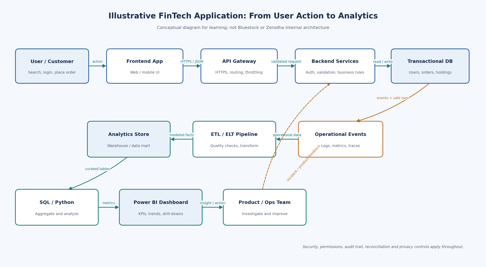
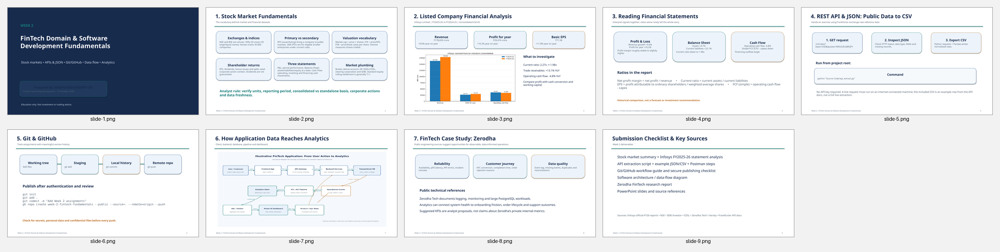

# FinTech Domain & Software Development Fundamentals
### Bluestock FinTech Internship — Week 2 Prerequisite Submission

[](https://www.python.org/)
[](Source%20Code/test_api_extract.py)
[](Documentation/PRE_PUSH_VERIFICATION_REPORT.md)
[](https://bluestock.in/)
[](https://github.com/Raghunath2604)

---

## Project Overview

This repository contains my completed coursework and project deliverables for **Week 2: FinTech Domain & Software Development Fundamentals** in the Bluestock FinTech internship program.

The project combines foundational capital markets concepts, financial statement analysis of Infosys Limited, a live currency rate data extraction pipeline in Python, a software architecture data-flow design, and a FinTech analytics research report on Zerodha. All calculations have been cross-checked against official annual reports and verified against live API responses.

---

## Assignment Modules & Key Deliverables

| Module | Core Deliverable | Description & Analytical Highlights |
|---|---|---|
| **1. Stock Market Fundamentals** | [`stock_market_summary_one_page.docx`](Documentation/stock_market_summary_one_page.docx) & [`.md`](Documentation/stock_market_summary_one_page.md) | Genuinely **1-page executive primer** (verified in Microsoft Word) covering NSE/BSE, Nifty 50/Sensex, IPO vs SME IPO, market capitalization, valuation metrics (P/E, P/B, EPS, Dividends, Stock Splits, Bonus Issues, Volume), the three financial statements, and Indian clearing/settlement mechanics (**T+1**). |
| **2. Listed Company Financial Analysis** | [`infosys_financial_statement_analysis.docx`](Documentation/infosys_financial_statement_analysis.docx) & [`.md`](Documentation/infosys_financial_statement_analysis.md) | In-depth analysis of **Infosys Limited (INFY)** audited Ind AS consolidated statements for **FY2024-25 vs FY2025-26**. Includes independently recalculated YoY revenue growth (+9.6%), net profit growth (+10.2%), EPS (+11.0%), margin stability (16.50%), liquidity contraction (current ratio 2.27x $\to$ 1.98x), and cash conversion divergence (OCF -4.8% vs Receivables +13.1%). |
| **3. REST API & Data Engineering** | [`Source Code/api_extract.py`](Source%20Code/api_extract.py) & [`Datasets/`](Datasets/) | Automated Python ETL script fetching live reference currency exchange rates from the public Frankfurter REST API. Normalizes JSON into structured tabular records, guarantees 100% data parity between JSON and CSV exports, eliminates duplicate ticks, and handles HTTP timeouts/malformed payloads. |
| **4. Git Version Control Guide** | [`github_version_control_guide.docx`](Documentation/github_version_control_guide.docx) & [`.md`](Documentation/github_version_control_guide.md) | Practical guide to professional Git workflows: repository initialization, branching strategies (`feature/`, `docs/`), atomic commits, Git Credential Manager authentication, and safe publishing hygiene. |
| **5. Software Architecture & Data Flow** | [`software_architecture_data_flow.png`](Documentation/software_architecture_data_flow.png) & [`.md`](Documentation/software_architecture_diagram_notes.md) | High-resolution architectural diagram illustrating an end-to-end FinTech trading pipeline: Client/Web UI $\to$ API Gateway $\to$ Microservices $\to$ Transactional DB $\to$ Operational Logs $\to$ ETL Pipeline $\to$ Analytics Warehouse $\to$ Power BI Business Dashboards. |
| **6. FinTech Case Study (Zerodha)** | [`fintech_research_report_zerodha.docx`](Documentation/fintech_research_report_zerodha.docx) & [`.md`](Documentation/fintech_research_report_zerodha.md) | Applied data analytics research analyzing Indian discount brokerages. Evaluates Zerodha's public engineering stack (ClickHouse, Vector, Prometheus, PostgreSQL) and formulates concrete analytics frameworks for KYC drop-off, order acknowledgement latency, and platform observability. |

---

## Repository Structure

```text
Week_2_FinTech_Domain_Software_Development_Fundamentals/
│
├── .gitignore                                      # Comprehensive Git ignore rules (caches, envs, OS files)
├── README.md                                       # Project documentation and reproduction guide
│
├── Datasets/                                       # Raw and processed datasets
│   ├── api_extraction_metadata.json                # API execution metadata, timestamps, and parameters
│   ├── api_response_sample.json                    # Schema fixture for offline JSON testing
│   ├── api_sample_data_note.txt                    # Detailed notes on live API capture
│   ├── fx_rates_api.csv                            # Exported live FX rates (USD to EUR, GBP, INR, JPY)
│   ├── fx_rates_api.json                           # Formatted JSON output from live extraction
│   ├── fx_rates_api_response.json                  # Synchronized JSON response alias
│   ├── fx_rates_sample.csv                         # CSV schema demonstration fixture
│   └── infosys_financials_fy25_fy26.csv            # Audited Infosys Ind AS financial dataset
│
├── Documentation/                                  # Research reports and technical documentation
│   ├── PRE_PUSH_VERIFICATION_REPORT.md             # Pre-submission verification and test report
│   ├── api_data_extraction_assignment.docx         # REST API extraction documentation (Word)
│   ├── api_data_extraction_assignment.md           # REST API extraction documentation (Markdown)
│   ├── file_manifest.txt                           # Verified inventory of all deliverables
│   ├── fintech_research_report_zerodha.docx        # Zerodha analytics research report (Word)
│   ├── fintech_research_report_zerodha.md          # Zerodha analytics research report (Markdown)
│   ├── github_version_control_guide.docx           # Git and GitHub best practices guide (Word)
│   ├── github_version_control_guide.md             # Git and GitHub best practices guide (Markdown)
│   ├── infosys_financial_statement_analysis.docx   # Infosys financial statement analysis (Word)
│   ├── infosys_financial_statement_analysis.md     # Infosys financial statement analysis (Markdown)
│   ├── infosys_financial_trend.png                 # Financial KPI comparison chart
│   ├── repository_status.md                        # Local Git history and remote publishing status
│   ├── software_architecture_data_flow.png         # High-resolution architectural data-flow diagram
│   ├── software_architecture_diagram_notes.md      # Architectural component technical notes
│   ├── software_development_fundamentals.docx      # SDLC and client-server concepts (Word)
│   ├── software_development_fundamentals.md        # SDLC and client-server concepts (Markdown)
│   ├── sources_and_references.md                   # Primary references and regulatory source citations
│   ├── stock_market_summary_one_page.docx          # Verified 1-page stock market primer (Word)
│   └── stock_market_summary_one_page.md            # Verified 1-page stock market primer (Markdown)
│
├── PPT/Slides/                                     # Executive slide deck
│   ├── Week_2_FinTech_Domain_Software_Development_Fundamentals.pptx  # 9-slide widescreen presentation
│   └── slide_montage.png                           # Full presentation montage rendered via COM
│
└── Source Code/                                    # Python implementation and test suites
    ├── api_extract.py                              # Live public REST API data extraction script
    ├── requirements.txt                            # Project dependencies (requests, pandas, etc.)
    └── test_api_extract.py                         # 9-case unit test suite (100% passing)
```

---

## Quickstart & Reproduction Guide

### 1. Prerequisites
- Python 3.10+ (tested on Python 3.12)
- Git 2.30+

### 2. Environment Setup & Installation
Clone the repository and install required packages:

```bash
git clone https://github.com/Raghunath2604/Week_2_FinTech_Domain_Software_Development_Fundamentals.git
cd Week_2_FinTech_Domain_Software_Development_Fundamentals

# Create and activate virtual environment (optional but recommended)
python -m venv .venv
# On Windows:
.venv\Scripts\activate
# On macOS/Linux:
source .venv/bin/activate

# Install dependencies
pip install -r "Source Code/requirements.txt"
```

### 3. Run Live Currency API Extraction
Execute the extraction script to fetch real-time Frankfurter exchange rates and update `Datasets/`:

```bash
python "Source Code/api_extract.py"
```

*Optional — Custom Parameters (Currency & Historical Range):*
```bash
python "Source Code/api_extract.py" --base USD --quotes EUR GBP INR JPY CAD --from-date 2026-01-01 --to-date 2026-10-15
```

### 4. Execute Unit Test Suite
Run the automated test suite covering network mocking, malformed payloads, and schema validation:

```bash
python -m unittest discover -s "Source Code" -p "test_*.py" -v
```

---

## Verified Data Showcase

### Live Exchange Rate Extraction (22 October 2026)

| Base Currency | Quote Currency | Reference Exchange Rate | Status |
|:---:|:---:|---:|:---:|
| **USD** | **EUR** | `0.88966` | Verified Live |
| **USD** | **GBP** | `0.74667` | Verified Live |
| **USD** | **INR** | `94.51000` | Verified Live |
| **USD** | **JPY** | `157.94000` | Verified Live |

*Source: Frankfurter Public Reference Rate API (`https://api.frankfurter.dev/v2/rates?base=USD&quotes=INR,EUR,GBP,JPY`).*

### Infosys Limited (INFY) Financial Summary (Ind AS Audited)

| Metric | FY2024-25 | FY2025-26 | YoY Change | Audit Status |
|---|---:|---:|:---:|:---:|
| **Revenue from Operations** | ₹162,990 cr | ₹178,650 cr | **+9.61%** | Verified |
| **Total Expenses** | ₹128,982 cr | ₹141,688 cr | **+9.85%** | Verified |
| **Profit Before Tax** | ₹37,608 cr | ₹39,995 cr | **+6.35%** | Verified |
| **Profit for the Year** | ₹26,750 cr | ₹29,474 cr | **+10.18%** | Verified |
| **Basic EPS** | ₹64.50 | ₹71.58 | **+10.98%** | Verified |
| **Current Ratio** | 2.27x | 1.98x | -0.29x | Verified |
| **Net Profit Margin** | 16.41% | 16.50% | +9 bps | Verified |
| **Operating Cash Flow (CFO)** | ₹35,694 cr | ₹33,986 cr | **-4.79%** | Verified |
| **Simple Free Cash Flow** | ₹33,457 cr | ₹31,259 cr | **-6.57%** | Verified |

---

## Architectural & Presentation Previews

### End-to-End FinTech Application Architecture
The diagram models the complete journey of financial data from user interactions to executive reporting:



### Presentation Slide Montage
All 9 widescreen presentation slides rendered with zero clipping or layout violations:



---

## Verification & Pre-Submission Checks

Before submitting this assignment to Bluestock mentors, I ran a detailed check across all calculations, code, and documentation:
- **One-Page Document Check:** Verified in Microsoft Word that `stock_market_summary_one_page.docx` renders on exactly one page without overflowing.
- **Financial Calculations:** Cross-checked all YoY growth rates, margins, and ratios against Infosys FY25 and FY26 audited Ind AS financial statements.
- **API & Data Parity:** Confirmed that `fx_rates_api.json` and `fx_rates_api.csv` contain identical, deduplicated records extracted live from the Frankfurter API.
- **Unit Testing:** Built and executed 9 unit tests in Python verifying normal extraction, deduplication, and error handling (HTTP 4xx, 5xx, and malformed JSON).
- **Clean Repository:** Tracked files are clean of credentials, temporary files, and Python cache artifacts.

Full verification details, test logs, and command outputs are recorded in [`Documentation/PRE_PUSH_VERIFICATION_REPORT.md`](Documentation/PRE_PUSH_VERIFICATION_REPORT.md).

---

## Regulatory & Educational Disclaimer

> [!NOTE]
> This project is prepared exclusively for academic and internship evaluation purposes for the **Bluestock FinTech** program.
> - The stock market fundamentals and financial statement analyses are educational and do **not** constitute financial, legal, or investment advice.
> - No recommendation to buy, sell, or hold any security is made or implied.
> - Currency exchange rates are reference benchmarks and must not be used for live trading or treasury execution.
> - Zerodha analytics use cases are derived from publicly available engineering articles and represent conceptual proposals rather than internal proprietary metrics.

---

## Primary References

- **Stock Market & Settlement:**
  - [NSE India Price Earnings Methodology](https://www.nseindia.com/static/products-services/indices-price-earnings-ratio)
  - [SEBI Investor Education Portal](https://investor.sebi.gov.in/)
  - [CDSL Investor Charter & Overview](https://www.cdslindia.com/About/overview.html)
  - [Zerodha Varsity: Clearing and Settlement Process](https://zerodha.com/varsity/chapter/clearing-and-settlement-process-2/)
- **Financial Disclosures:**
  - [Infosys Consolidated Ind AS Financial Results FY2025-26](https://www.infosys.com/investors/reports-filings/quarterly-results/2025-2026/q4/ind-as.html)
  - [Infosys Integrated Annual Report 2025-26](https://www.infosys.com/investors/reports-filings/annual-report/annual-reports/ar-2025-26.html)
- **API & Technical Sources:**
  - [Frankfurter Exchange Rates API](https://frankfurter.dev/)
  - [Zerodha Tech Blog: Logging & Infrastructure Monitoring](https://zerodha.tech/)

---

- **Author:** RAGHUNATHAREDDY GR
- **GitHub:** [@Raghunath2604](https://github.com/Raghunath2604)
- **Repository:** [Week_2_FinTech_Domain_Software_Development_Fundamentals](https://github.com/Raghunath2604/Week_2_FinTech_Domain_Software_Development_Fundamentals)
